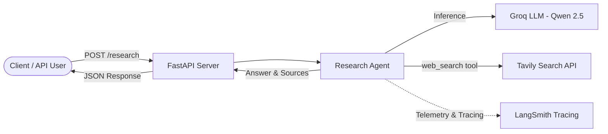

# Riplex

An AI-powered Research Agent API built with **FastAPI**, **LangChain**, **Groq** (`qwen/qwen3.8-27b`), and **Tavily Search**, with automated tracing support via **LangSmith**.

---

## Architecture Overview



---

## Features

- **FastAPI REST API**: High-performance asynchronous API endpoints with automatic OpenAPI documentation.
- **Autonomous Research Agent**: Uses LangChain tool-calling agents powered by Groq's high-speed inference.
- **Real-time Web Search**: Integrated Tavily search tool providing grounded, current internet data with citations.
- **Validated Schemas**: Strict Pydantic models for request validation, source extraction, and reporting.
- **Built-in LangSmith Tracing**: Zero-boilerplate agent observability and step-by-step reasoning logs.
- **Comprehensive Pytest Suite**: 100% test coverage across all layers with offline mocks.

---

## Project Structure

```text
riplex/
├── src/
│   └── riplex/
│       ├── __init__.py           # CLI entrypoint
│       ├── main.py               # FastAPI application (/health, /research)
│       ├── core/
│       │   └── config.py         # Environment variables & configuration
│       ├── schemas/
│       │   └── research.py       # Pydantic models (RequestResearch, Source, ResearchReport)
│       └── services/
│           ├── agent.py          # LangChain Groq agent setup & invocation
│           ├── tools.py          # LangChain web_search tool wrapper
│           └── search.py         # Tavily web search service
├── test/
│   ├── test_agent.py             # Agent service unit tests
│   ├── test_api.py               # FastAPI endpoints & OpenAPI tests
│   ├── test_config.py            # Core configuration tests
│   ├── test_init.py              # CLI entry point tests
│   ├── test_research_schema.py   # Pydantic schema validation tests
│   ├── test_search.py            # Tavily search service unit tests
│   └── test_tools.py             # LangChain tool unit tests
├── pyproject.toml                # Project metadata & dependencies
└── README.md
```

---

## Getting Started

### Prerequisites

- **Python 3.14+**
- **uv** (recommended) or **pip**

### 1. Clone & Install Dependencies

Using `uv`:
```powershell
# Clone the repository
git clone https://github.com/0xRakkesh/riplex.git
cd riplex

# Sync dependencies using uv
uv sync
```

Or using standard `pip`:
```powershell
python -m venv .venv
.\.venv\Scripts\activate
pip install -r requirements.txt
```

---

## Environment Configuration

Create a `.env` file in the project root:

```env
# Groq API Key (https://console.groq.com)
GROQ_API_KEY=gsk_...

# Tavily API Key (https://tavily.com)
TAVILY_API_KEY=tvly-...

# LangSmith Tracing (Optional - https://smith.langchain.com)
LANGSMITH_TRACING=true
LANGSMITH_API_KEY=lsv2_pt_...
LANGSMITH_ENDPOINT=https://api.smith.langchain.com
LANGSMITH_AGENT_ID=riplex
LANGSMITH_AGENT_ENVIRONMENT=LOCAL
```

---

## Running the Application

### Start the FastAPI Server

```powershell
uv run uvicorn riplex.main:app --reload
```

Once running, interactive documentation is available at:
- **Swagger UI**: [http://127.0.0.1:8000/docs](http://127.0.0.1:8000/docs)
- **ReDoc**: [http://127.0.0.1:8000/redoc](http://127.0.0.1:8000/redoc)

---

## API Endpoints

### 1. Health Check
- **Method**: `GET`
- **Path**: `/health`
- **Response**:
```json
{
  "status": "ok"
}
```

### 2. Research Query
- **Method**: `POST`
- **Path**: `/research`
- **Headers**: `Content-Type: application/json`
- **Request Body**:
```json
{
  "question": "What are the latest developments in quantum computing?"
}
```
- **Response**:
```json
{
  "question": "What are the latest developments in quantum computing?",
  "answer": "Recent developments in quantum computing include advances in neutral-atom processors, error-mitigation techniques..."
}
```

---

## Observability with LangSmith

LangChain automatically traces agent executions when credentials are present in `.env`:
1. Ensure `LANGSMITH_TRACING=true` and `LANGSMITH_API_KEY` are configured in `.env`.
2. Start the API server and send queries.
3. Visit [smith.langchain.com](https://smith.langchain.com) to view:
   - Complete agent reasoning chains.
   - External tool calls to Tavily.
   - LLM latency, input/output tokens, and costs.

---

## Running Tests

The test suite uses `pytest` with mocks to test all components without external API costs or network dependencies.

Run all tests:
```powershell
.\.venv\Scripts\pytest.exe -v
```

Or using `uv`:
```powershell
uv run pytest -v
```

---

## License

This project is licensed under the MIT License.
